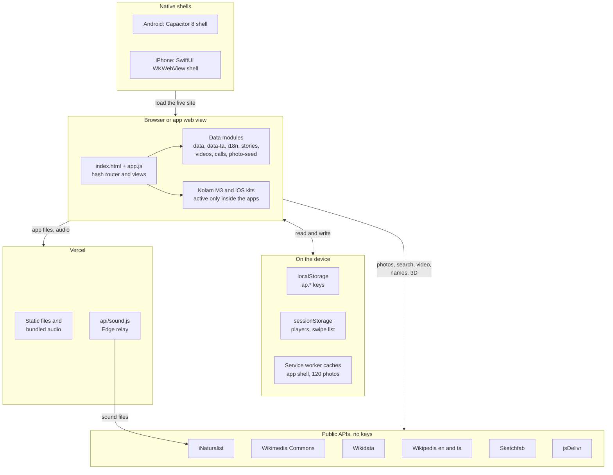
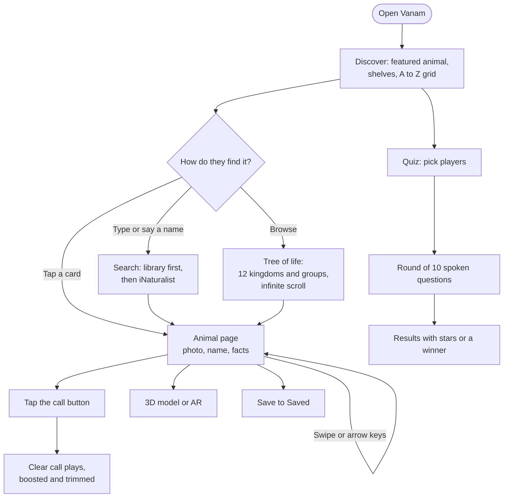
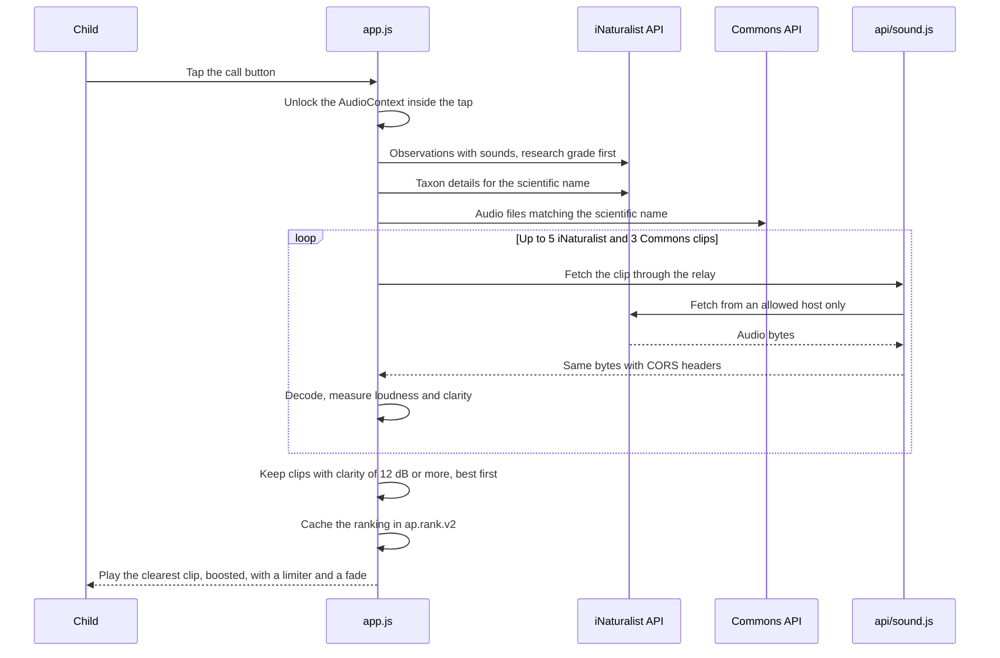
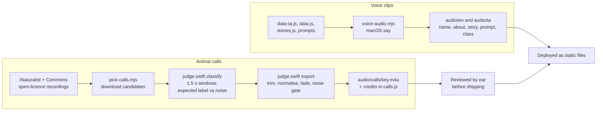
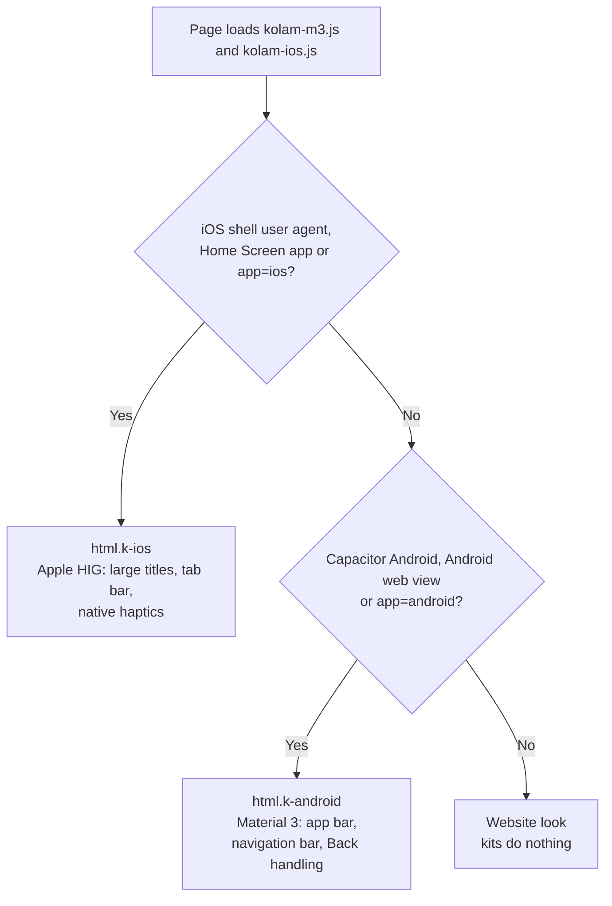
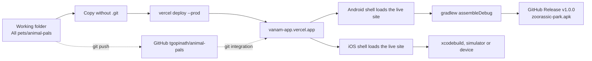

# Vanam (வனம்)

Vanam is a bilingual (English and Tamil) field guide for young children: real photos, real recorded animal calls, short videos, 3D models and AR, six spoken quiz games and a read-aloud story for every library animal. It is a plain JavaScript single-page app with no build step. The core idea is "real data, made safe for kids": everything comes from open sources (iNaturalist, Wikimedia Commons, Wikidata, Wikipedia, Sketchfab), but the 58 hand-picked library animals use only reviewed, pinned assets, and live lookups for any other species pass through word filters and a sound-clarity test before a child sees or hears them.

| Platforms | Stack | Data | Hosting |
|---|---|---|---|
| Web PWA, Android app (Capacitor shell), iPhone app (SwiftUI shell) | Vanilla JS ES modules, Web Audio API, one Vercel Edge function | iNaturalist, Wikimedia Commons, Wikidata, Wikipedia, Sketchfab, bundled calls and voice clips | Vercel (vanam-app.vercel.app), APK on GitHub Releases |

## System architecture

The browser does almost all of the work. `index.html` loads `app.js` and seven data modules as ES modules (all preloaded with `modulepreload`), plus the shared Kolam M3 and Kolam iOS kits from the Kolam design system site. Most network calls go straight from the browser to public APIs that send CORS headers. The one exception is iNaturalist's sound files, which have no CORS headers, so they go through a tiny Vercel Edge function (`api/sound.js`) that only relays files from three allowed hosts. There is no database and no sign-in: sign-in was removed, and `auth.js` is now an empty placeholder kept only because the service worker lists it.

*Everything runs in the page; the only server code is a 24-line sound relay.*

## Main user flow

The core job is "show my child a real animal and let them hear it". A child (or parent) lands on Discover, which shows a featured animal of the day and sideways shelves of animals, taps a card, and gets a full-screen animal page with photos (and a video thumbnail where one exists), a big "call" button, 3D, AR and Save. From there they can swipe to the next animal in the same list, or jump into the games.

*Every name, prompt and answer in the games has a speaker button, so children who cannot read yet can play.*

## Data flow and state

### Playing an animal's call

Library animals with a bundled call play `audio/calls/<key>.m4a` directly (29 such files, already trimmed and levelled). For every other animal the app gathers candidates, measures them, and plays only a clear one. The sequence below is for a species without a bundled call.

*Commons files are fetched directly because upload.wikimedia.org already sends CORS headers. If no clip is clear enough, the app speaks the animal's name instead and says that no clear recording was found.*

### Where state lives

| Store | Key or name | What it holds |
|---|---|---|
| localStorage | `ap.photos.v3` | Main photo, credit and ancestry of each library animal (seeded from `photo-seed.js`, refreshed once a day) |
| localStorage | `ap.vcache.v1`, `ap.rank.v2`, `ap.3d.v1` | Live video lookups (kept a week), ranked sound URLs, Sketchfab model picks per species |
| localStorage | `ap.taNames.v1`, `ap.gpics.v1`, `ap.totals.v1` | Tamil names from Wikidata, group chip photos, species counts per group |
| localStorage | `ap.faves`, `ap.recent`, `ap.lang` | Saved animals, "Continue exploring" shelf, English or Tamil |
| localStorage | `ap.roster`, `ap.names`, `ap.gameGroup`, `ap.score*`, `ap.asked`, `ap.memory.best` | Player names, chosen game group, scores, questions already asked, best memory score |
| sessionStorage | `ap.play`, `ap.nav`, `ap.jumpStory` | Current players and turn, the list used for swipe next and previous, a story to open |
| Cache Storage | `ap-shell-v76-ios`, `ap-img-v2` | App files and the Kolam kits; the 120 most recent iNaturalist photos |

No personal data leaves the device: the sound relay only ever sees the address of a public recording. There are no accounts.

## Key modules

| File / module | Responsibility |
|---|---|
| `index.html` | Icon sprite, header with search and language switch, tab bar, voice-search and 3D viewer overlays, loads the Kolam M3 and iOS kits |
| `app.js` | Everything else, about 1,800 lines: hash router, views (Discover, Tree of life, search, animal page, Saved, games, stories), sound pipeline, video lookup, 3D and AR, app modes |
| `data.js` | The 58 library animals (iNaturalist taxon id, category, call text, bio, habitat, food, fun fact, 3D model for 54 of them), the 12 tree-of-life kingdoms, GLB model URLs |
| `data-ta.js`, `i18n.js` | Hand-written Tamil for the 58 animals; all interface text in English and Tamil |
| `stories.js` | One short English and Tamil story per library animal |
| `videos.js` | One reviewed Wikimedia Commons clip for 44 library animals (small and large WebM, MOV fallback for Safari) |
| `calls.js` | Credits and licence for the 29 bundled calls |
| `photo-seed.js` | Library photos shipped with the app, so Discover renders before any API reply |
| `api/sound.js` | Edge relay: HTTPS only, three allowed hosts, 15 MB limit, long cache headers |
| `sw.js` | Offline shell (cache first, refreshed in the background), photo cache, leaves audio and video to the browser |
| `tools/pick-calls.mjs` + `tools/judge.swift` | Offline: pick, trim and level one clear call per library animal with Apple's SoundAnalysis classifier |
| `tools/voice-audio.mjs` | Offline: record name, about, story, prompt and group clips with macOS voices (Samantha for English, Vani for Tamil) |
| `tools/photo-seed.mjs`, `tools/shots.mjs` | Regenerate the photo seed; capture portfolio screenshots |
| `tools/backup-media.mjs`, `tools/backup-species.py` | Back up media to Google Drive through rclone (run by hand) |

### The bundled-audio pipeline

The clearest sounds and all voice clips are made ahead of time on a Mac, then shipped as small `.m4a` files.

*`voice-audio.mjs` keeps a hash per clip in `audio/.hashes.json` and re-records only clips whose text changed. Recorded voices are used because many phones have no Tamil voice and iPhone speech is unreliable.*

### Kid-safety filters for live content

| Content | Library animals | Any other species |
|---|---|---|
| Video | Only the pinned clip in `videos.js` | Commons search, skipping titles that match a filter for predation, injury and mating; 4 to 240 s, at least 480 px wide |
| Sound | Bundled call, or ranked clips | Ranked clips with clarity at or above 12 dB; ambience is dropped |
| 3D | Hand-checked Sketchfab or GLB model | Sketchfab staff picks first, then liked models (10 or more likes), name must match, not age-restricted, and a long block-list of words (people, monsters, weapons, toys, gore) |

## Platforms

### Web and PWA

The website has its own dark, editorial look (Inter and Fraunces fonts, Netflix-style hero and shelves, a masonry photo wall). It is installable as a PWA (`manifest.json`, standalone, theme `#0E0E0E`) and the service worker keeps the app shell offline.

### Android app

A Capacitor 8 "remote" shell in `android-wrappers/zoorassic-park` (app id `com.gopinath.zoorassicpark`, name Vanam) that loads `https://vanam-app.vercel.app`. It adds `@capacitor/app` for the hardware Back button and declares `RECORD_AUDIO` for voice search. A `.keep-native` file stops the shared build script from overwriting its adaptive icon, splash and bar colours. Inside it, the Kolam M3 kit sets `html.k-android` and `app.js` builds a Material 3 top app bar, a navigation bar with four destinations, ripples and a snackbar; Back closes the 3D viewer or search first.

### iPhone app

A SwiftUI `WKWebView` shell in `Vanam-iOS` (bundle id `com.gopinath.ZoorassicPark`, kept from the old name so it replaces the earlier app). It adds `Vanam-iOS` to the user agent, sets `AVAudioSession` to playback so sounds play with the silent switch on, allows inline media without a tap, enables edge-swipe back, opens outside links in `SFSafariViewController`, forwards haptics from the page and shows a native offline screen. The Kolam iOS kit sets `html.k-ios` and `app.js` configures large titles, back plus centred title, and a tab bar with four tabs and a trailing Search tab.

*`?app=ios`, `?app=android` and `?app=web` force a look for testing. Swipe left or right changes animal in both apps; edge swipes are left to the system back gesture.*

## Data sources and APIs

| Source | Used for | Licence / key |
|---|---|---|
| iNaturalist API v1 | Taxa, photos, search, tree-of-life lists, field recordings, Tamil common names | Free, no key; photos and sounds carry their own CC licences and credits shown in the app |
| Wikimedia Commons API | Videos for non-library species, extra sound candidates, the pinned library clips | Free, no key; each file's licence and page are linked |
| Wikidata SPARQL | Tamil names, matched through property P3151 (iNaturalist taxon id) | Free, no key; CC0 |
| Wikipedia (en, ta) | Tamil summaries through language links; English bios for non-library species come from iNaturalist's Wikipedia summary | Free, no key; CC BY-SA |
| Sketchfab | 3D model search, embeds and Sketchfab AR | Free, no key for search and embed |
| jsDelivr | `@google/model-viewer` 3.5.0 (loaded only when a GLB opens), three.js and Khronos sample GLB models | Free CDN |
| Bundled files | 29 calls in `audio/calls`, 185 voice clips per language in `audio/en` and `audio/ta` | Calls credited in `calls.js`; voices rendered with macOS |

## Offline, performance, privacy and accessibility

- **Offline:** the service worker answers app files from the cache at once and refreshes them in the background, so a new release shows on the second open. Photos seen recently stay available, so Saved works offline. Audio and video are left to the browser because Safari needs byte-range replies.
- **Speed:** `photo-seed.js` lets Discover render with no API wait; shelves fill only when they come near the screen; the A to Z grid and tree lists load through an `IntersectionObserver`; Commons lookups run one at a time with a 700 ms gap because Commons rate-limits bursts.
- **Sound handling:** every play or stop bumps a counter, so a clip that finishes loading after the child tapped something else never takes over.
- **Privacy:** no accounts, no analytics, no server-side storage. The relay passes only audio from three hosts and stores nothing.
- **Accessibility:** icon buttons carry `aria-label`s in the current language, the language switch is a `role="switch"`, pressed states use `aria-pressed`, the 3D viewer closes with Escape, and Tamil text is marked `lang="ta"` so it gets the Noto Sans Tamil font.
- **Children:** video previews play on hover or press-and-hold only, never on their own.

## Build and deploy

There is no build step. The repository is connected to Vercel, so a push to `main` creates a production deployment. In practice the live site is currently deployed with the Vercel CLI from a copy of the working folder without `.git` (Vercel's Hobby plan blocked CLI deploys from the git folder because of the commit author). The shells are built separately.

*Dashed lines: the git path exists but `main` on GitHub is behind the live code (see the limits below). Older addresses zoorassic-park.vercel.app and animal-pals-ivory.vercel.app still answer.*

## Known limits and next steps

- **GitHub `main` lags the live app.** Much of the current code (stories, i18n, photo seed, the Kolam kits, most voice clips) is not committed yet, and the GitHub Pages copy of the repo shows that older version. Because the repo is git-connected, a push to `main` would replace the live site with the older code. Committing the working folder first, then deploying from git, would make the repo the single source of truth.
- The Android shell's offline page (`www/index.html`) still says "Zoorassic Park" and links to the old address.
- The APK is a debug build, installed by side-loading; the iPhone app installs only through Xcode until it goes through TestFlight.
- `app.js` is one large file; splitting the sound pipeline, games and app modes into modules would make it easier to test.
- Live lookups for non-library species depend on word filters and a loudness measure, not human review; only the 58 library animals are fully vetted.
- The Kolam kits load from the Kolam site at runtime; if that site is down on a first visit, the apps fall back to the website look.

---

Written from the source code on 17 November 2026. Source: [github.com/tgopinath/animal-pals](https://github.com/tgopinath/animal-pals) (web app) and [github.com/tgopinath/Vanam-iOS](https://github.com/tgopinath/Vanam-iOS) (iPhone shell).
